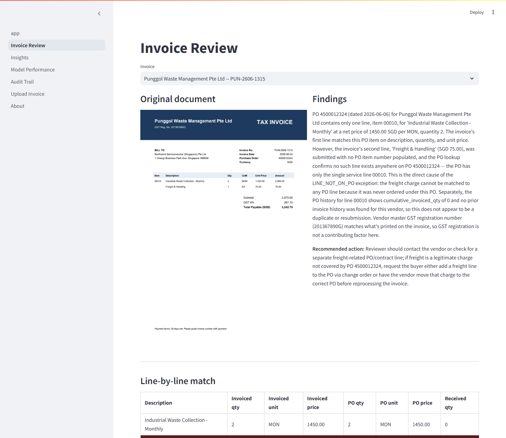

# Invoice Exception Agent

AI-assisted accounts-payable exception review — three-way match and
Singapore GST validation decide deterministically; Claude extracts
invoice fields and explains exceptions in plain English.

**Live demo:** https://invoice-exception-agent-bhnd3tg9okgvhsj6iwhwkw.streamlit.app/



- **0 / 61 false approvals** on the full evaluation set — the one hard requirement, and it holds.
- **95.6% extraction field accuracy** across 217 real invoices, 7 document layouts.
- **$0.023 per invoice** processed, real Claude API cost, extraction + investigation combined.

## How it works

Claude reads an unstructured invoice into structured fields. Plain
deterministic Python checks it against purchasing records — invoice vs.
purchase order vs. goods receipt, Singapore GST at 9% — and decides
auto-approve or exception. An LLM never does arithmetic and never
decides pass/fail; anything it can't verify goes to a human. Exceptions
get investigated by one bounded, read-only agent (hard tool-call cap, no
approve/reject capability) that explains *why*, then a reviewer
approves, rejects, holds, or asks the vendor for a correction.

```
invoice PDF ──► Extract (Claude) ──► Match + GST (deterministic) ──► Decide
                                                                        │
                                              ┌─────────────────────────┤
                                              ▼                         ▼
                                         Auto-approve            Investigate (Claude, read-only)
                                                                        │
                                                                        ▼
                                                              Human: approve / reject / hold
```

## Run it yourself

```bash
cp .env.example .env               # add your ANTHROPIC_API_KEY, set a local DATABASE_URL
docker compose up -d               # Postgres
pip install -r requirements.txt

python scripts/generate_mock_sap.py
python scripts/generate_invoices.py
python scripts/load_db.py

pytest                             # 102 tests
streamlit run app.py               # http://localhost:8501
```

## More detail

- [`docs/design_decisions.md`](docs/design_decisions.md) — why deterministic validation, why one bounded read-only agent, why no agent framework.
- [`docs/data_sources.md`](docs/data_sources.md) — where every validation rule and SAP field comes from.
- [`docs/eval_report.md`](docs/eval_report.md) — full evaluation numbers: per-layout accuracy, per-issue precision/recall, prompt-injection resistance, cost and latency.
- [`docs/decisions_log.md`](docs/decisions_log.md) — the 10 most interview-relevant decisions and bugs found while building this, with a link to the complete unabridged log.

## What this doesn't do

- No real SAP/ERP connection — the purchasing data is synthetic, shaped like real SAP tables, not a live integration.
- Singapore GST only, at a flat 9% rate.
- The investigation agent proposes a resolution; it never has approve/reject authority. Deliberate, not a missing feature.
- Scored against a real but bounded evaluation set (217 invoices) — see the live demo's Model Performance page for exactly where accuracy is weakest.
- The hosted database (Databricks Lakebase, Free Edition) is scoped to personal/non-commercial use — not a production deployment pattern as-is.
